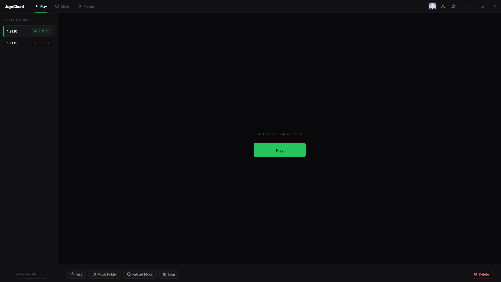
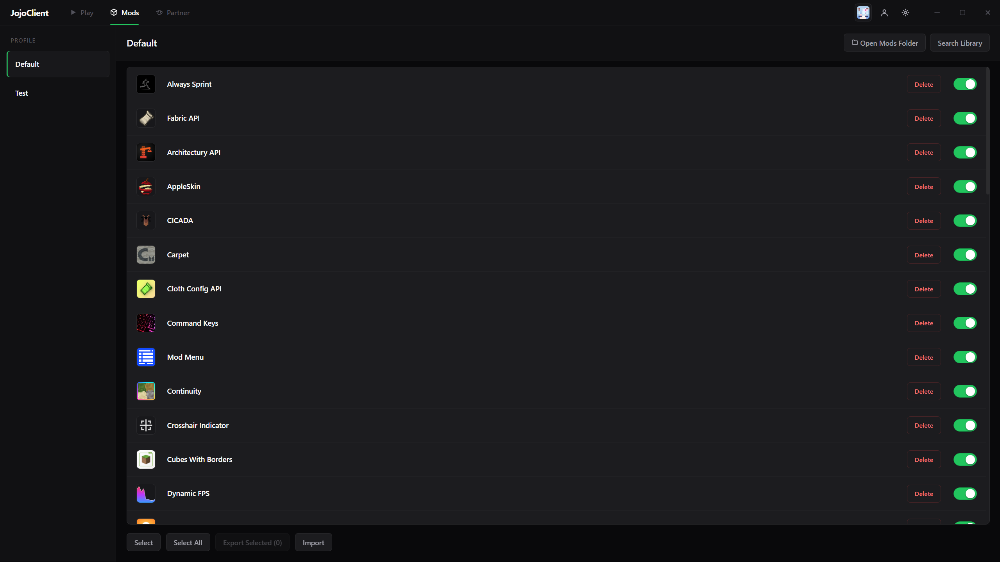
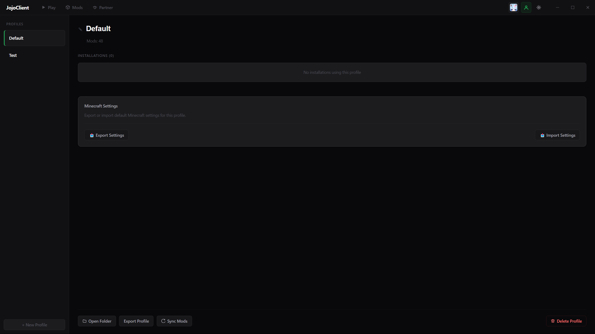

# JojoClient

JojoClient is a free, Fabric-native Minecraft launcher for Windows. Keep one mod list and use it on every Minecraft version, without the manual folder shuffling.

**[Download JojoClient for Windows →](https://github.com/Jonas1903/JojoClient/releases/latest)**



---

## Why JojoClient

- **One mod list, every version.** A profile holds your mods, configs and keybinds. Every installation under it can run a different Minecraft version and gets the matching mod builds automatically. Mods without a build for that version are skipped and shown in the launcher.
- **Broken mods are caught before the crash.** Fabric dependencies are resolved and checked before every launch. If the game crashes on startup, the launcher repairs known causes and retries.
- **Share your setup as one small file.** Export your mod list and configs as a file of a few KB. Your friend imports it and JojoClient downloads the mods from Modrinth.



---

## Features

- Microsoft / Xbox / Minecraft account login with multi-account support
- Profiles with multiple installations, each with its own Minecraft and Fabric version
- Mod search and one-click install from Modrinth, with transitive dependency resolution
- Pre-launch dependency check and automatic crash recovery
- Settings and configs flow back from the game into the profile
- Profile export and import (file or folder)
- Automatic Java runtime install (Adoptium Temurin)
- SHA-1 verification on every downloaded file
- Automatic launcher updates, light and dark theme



---

## Install

1. Download `JojoClient-Windows-Setup.exe` from the [latest release](https://github.com/Jonas1903/JojoClient/releases/latest).
2. Run it. Windows may show a "Windows protected your PC" warning because the installer is not code-signed yet. Click **More info**, then **Run anyway**.
3. Sign in with your Microsoft account. You need a Minecraft: Java Edition license. There is no JojoClient account.

---

## Open source

The full source code of the launcher is in this repository. You can read what it does with your account and your files, build it yourself, or report problems in the [issues](https://github.com/Jonas1903/JojoClient/issues).

Your Microsoft sign-in goes straight to Microsoft, Xbox Live and Mojang (`src/main/services/auth.ts`). JojoClient has no server of its own and never sees your password.

### Build from source

Requires Windows, Node.js 22 or newer and Git.

```bash
git clone https://github.com/Jonas1903/JojoClient.git
cd JojoClient
npm ci
npm run build
```

The installer is written to `release/<version>/`. For development, `npm run dev` starts the app with hot reload, and `npm run test` runs the test suite.

### Verify a download

From v1.0.8 on, releases are built by [GitHub Actions](.github/workflows/release.yml) from the code in this repository, and every installer comes with a signed build attestation. With the [GitHub CLI](https://cli.github.com/) you can check that an installer was built from this repository:

```bash
gh attestation verify JojoClient-Windows-<version>-Setup.exe -R Jonas1903/JojoClient
```

---

## Limitations

- Windows only
- Fabric only (no Forge, NeoForge or Quilt)
- Mods come from Modrinth (no CurseForge)
- No modpack import (`.mrpack`, CurseForge)

---

## Links

- Website: [jojoclient.com](https://jojoclient.com/)
- [Impressum](https://jojoclient.com/impressum.html)
- [Datenschutzerklärung](https://jojoclient.com/datenschutz.html)

---

## License

JojoClient is licensed under the [GNU General Public License v3.0](LICENSE). Not affiliated with Mojang or Microsoft.
